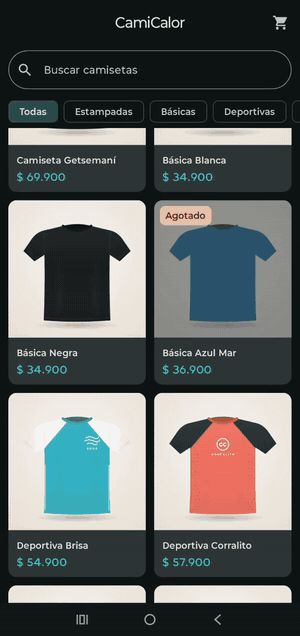
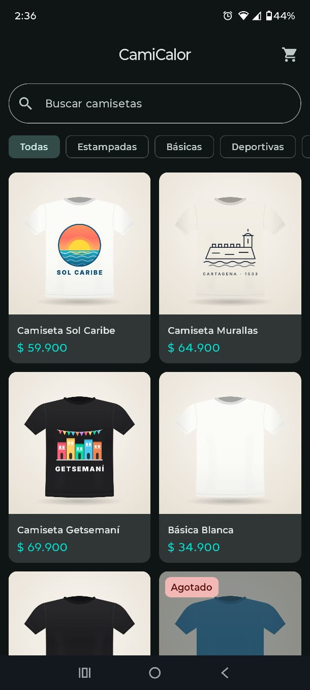
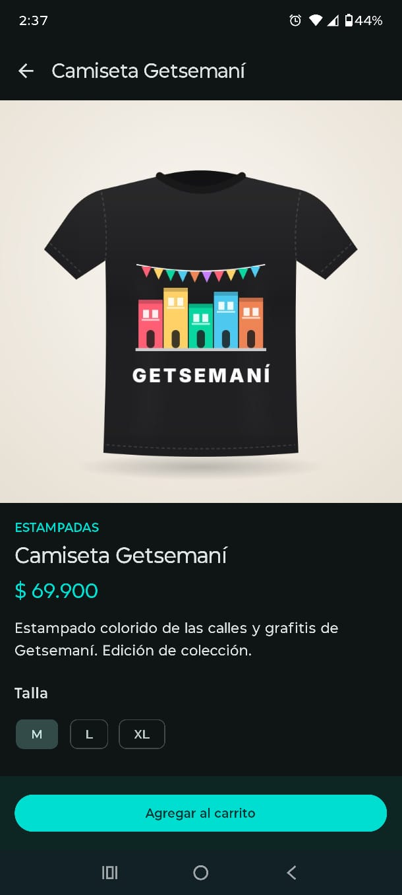
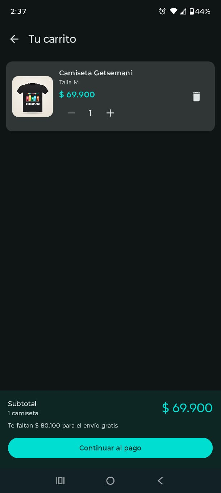
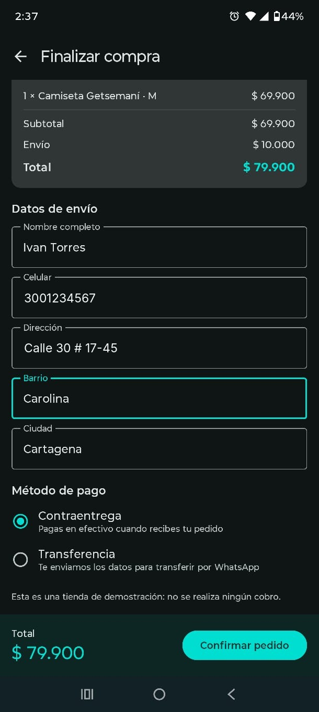
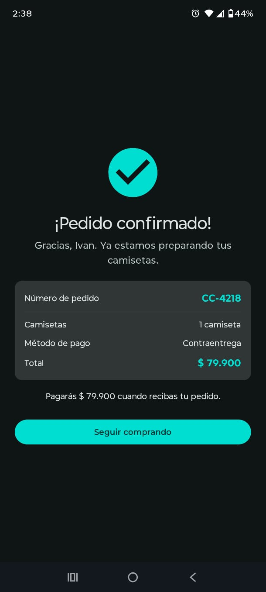
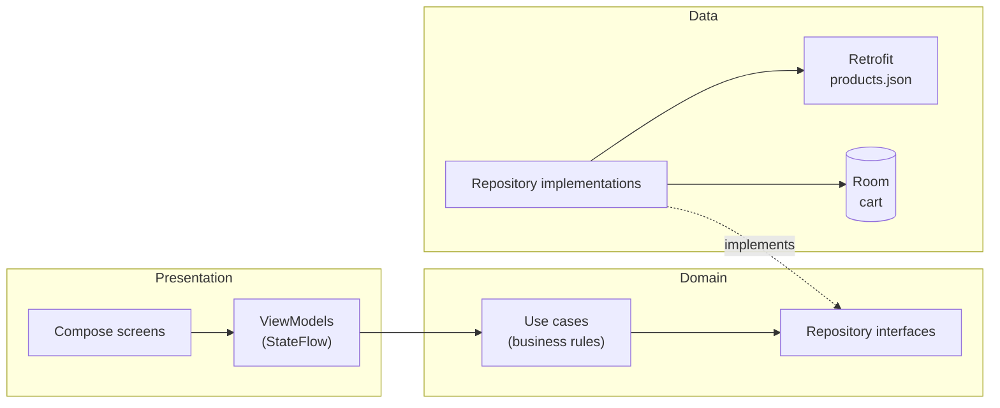

# CamiCalor 🌞

[](https://github.com/IvanArroyo28/camicalor-android/actions/workflows/android-ci.yml)


A T-shirt store Android app inspired by Cartagena, Colombia — built with **Kotlin**, **Jetpack Compose** and **Clean Architecture**.

## About

<!-- ✍️ Ivan: write 2–3 sentences here in your own English: what CamiCalor is and why you built it. -->

## Demo

<p align="center">
  
</p>

| Catalog | Product detail | Cart | Checkout | Confirmation |
|:---:|:---:|:---:|:---:|:---:|
|  |  |  |  |  |

## Download

Get the latest APK from **[Releases](https://github.com/IvanArroyo28/camicalor-android/releases/latest)** and install it on any Android 8.0+ device.

## Features

- **Catalog** loaded from a remote JSON API, with loading, error and empty states
- **Search** that ignores accents and uppercase ("basica" finds "Básica")
- **Category filter** combined with search
- **Product detail** with size selection and out-of-stock handling
- **Persistent cart** stored with Room — it survives closing the app
- **Live cart badge** that updates from any screen
- **Checkout** with form validation (Colombian mobile numbers) and two simulated payment methods
- **Shipping rules**: flat fee, free shipping from $150.000 COP, and a "you're $X away from free shipping" hint
- **Order confirmation** with a clean back stack (back goes to the catalog, not to the form)

> This is a demo store: no real payments are processed.

## Tech stack

| Area | Tools |
|---|---|
| Language | Kotlin 2.2, Coroutines, Flow |
| UI | Jetpack Compose, Material 3, Navigation Compose (type-safe routes) |
| Architecture | Clean Architecture (presentation / domain / data), MVVM, unidirectional data flow |
| Dependency injection | Hilt |
| Network | Retrofit + Kotlinx Serialization |
| Local storage | Room |
| Images | Coil 3 |
| Testing | JUnit 4, fakes for repositories and APIs |
| CI | GitHub Actions (unit tests + debug build on every push) |

## Architecture



- **Domain** is pure Kotlin: models, repository interfaces and use cases. It doesn't know about Android, Retrofit or Room.
- **Data** implements the domain interfaces. DTOs are mapped to domain models, so a change in the JSON only touches the data layer.
- **Presentation** exposes one immutable UI state per screen (`sealed interface`) and one-time events (snackbars) through a `Channel`.

Some decisions worth mentioning:

- Prices are stored as `Long` in pesos — never `Double` for money.
- The cart is **observed** from Room as a `Flow`: when a quantity changes, every screen updates automatically.
- Cart rows use a composite key `(productId, size)`, and "add one more" runs inside a `@Transaction`.
- Business rules (stock, valid sizes, max quantity, shipping, form validation) live in use cases and are covered by unit tests.

## Project structure

```
app/src/main/java/com/ivanarroyo/camicalor/
├── data/          # Retrofit API, DTOs, Room (entity, DAO, database), mappers, repositories
├── di/            # Hilt modules
├── domain/        # Models, repository interfaces, use cases
└── presentation/  # Screens, ViewModels and UI state: catalog, detail, cart, checkout, confirmation
api/
├── products.json  # Product catalog served as a static API
└── images/        # Product images
```

## Getting started

Requirements: Android Studio (latest stable) and JDK 21.

```bash
git clone https://github.com/IvanArroyo28/camicalor-android.git
```

Open the project in Android Studio, let Gradle sync, and run the `app` configuration.

### Run the tests

```bash
./gradlew testDebugUnitTest
```

39 unit tests cover mappers, the repository cache, search and filters, cart rules, shipping and checkout.

## Roadmap

- [ ] Order history
- [ ] User accounts
- [ ] Color variants
- [ ] UI tests with Compose testing
- [ ] Real payment integration

## Credits

All T-shirt designs were created specifically for this project.

## License

[MIT](LICENSE) © Ivan Arroyo
